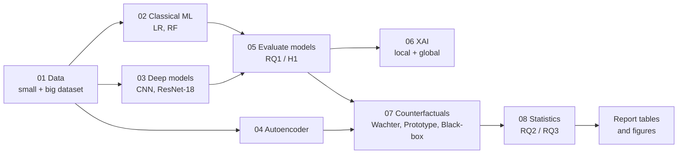

# Project Architecture

KF7029 MSc project: *What Would Change the Prediction? Counterfactual XAI for Fashion Image Classification*

This project follows the supervisor's plan:

| Supervisor note | Where it is in the code |
|---|---|
| Fashion Image Classification (FIC) | `fic.data` (Fashion-MNIST + a second dataset) |
| Small / big dataset | Fashion-MNIST + Fashion Product Images (`scripts/00_prepare_fashion_products.py`, `datasets.big`) |
| Model: CNN (self-built) | `fic.models.cnn.SimpleCNN` |
| Model: ResNet-18 | `fic.models.resnet.ResNet18Classifier` (ImageNet pretrained, fine-tuned) |
| Classical ML: Random Forest, Logistic Regression | `fic.models.classical` (scikit-learn) |
| XAI: local and global explanations | `fic.xai.local`, `fic.xai.global_` |
| CFX for all models, compared (supervisor email, Nov 2026) | `fic.counterfactuals`: Wachter + prototype on LR, CNN, ResNet-18; black-box on all four |

## 1. Pipeline



Each step is one script in `scripts/`. Every script reads `configs/default.yaml`,
writes its results into `outputs/`, and can be run on its own or through
`scripts/run_pipeline.py`.

## 2. Code layout

```
fic-cfx/
├── configs/
│   ├── default.yaml          full experiment (5 seeds, 1,000 images)
│   └── first_results.yaml    short run for a first look (1 seed, 100 images)
├── data/raw/                 datasets (downloaded automatically)
├── docs/architecture.md      this file
├── notebooks/                your exploration notebooks
├── outputs/                  everything the code produces
│   ├── models/               trained models (.pt, .joblib)
│   ├── predictions/          test-set probabilities per model and seed
│   ├── counterfactuals/      one CSV per model and method
│   ├── metrics/              accuracy and statistics tables (CSV)
│   ├── figures/              plots for the report
│   └── logs/                 training logs
├── scripts/                  01 ... 08 pipeline steps + run_pipeline.py
├── src/fic/                  the Python package (all real logic lives here)
│   ├── config.py             YAML loading, output paths
│   ├── cli.py                shared command-line options (--dataset, --seeds, --quick)
│   ├── data/                 datasets.py
│   ├── models/               cnn.py, resnet.py, classical.py, registry in __init__.py
│   ├── training/             torch_trainer.py (early stopping)
│   ├── xai/                  local.py (Grad-CAM, saliency), global_.py
│   ├── counterfactuals/      wachter.py, prototype.py, blackbox.py, autoencoder.py
│   ├── evaluation/           metrics.py, selection.py
│   ├── stats/                tests.py (McNemar, Wilcoxon, Holm, bootstrap)
│   ├── visualization/        plots.py
│   └── utils/                seed.py, device.py, logger.py
└── tests/                    pytest unit tests
```

Design rules:
* **Scripts are thin, the package does the work.** Scripts only parse arguments,
  call functions in `src/fic`, and save results. This keeps logic testable.
* **One config file.** No numbers are hard-coded in scripts.
* **Same input for every model.** Images are float tensors in [0, 1]. The ResNet-18
  wrapper resizes and normalises inside `forward()`, so counterfactuals for all
  models are made and measured at the original resolution.
* **Reproducible.** Seeds for Python, NumPy and PyTorch are fixed (`fic.utils.seed`).

## 3. Models

| Model | Type | Input | Explained with |
|---|---|---|---|
| Logistic Regression | classical, linear | flattened pixels | Wachter, Prototype (via an exact PyTorch copy), Black-box, weight maps |
| Random Forest | classical, trees | flattened pixels | Black-box prototype CF, pixel importance |
| Self-built CNN | deep, from scratch | image | Wachter, Prototype, Black-box, Grad-CAM |
| ResNet-18 | deep, ImageNet pretrained | image (resized to 224) | Wachter, Prototype, Black-box, Grad-CAM |

Random Forest has no gradients, so the gradient-based methods cannot be used on it.
`fic.counterfactuals.blackbox` gives a model-agnostic prototype method that only
calls `predict()`, so classical ML can still be compared.

## 4. Explanations

**XAI (supervisor note: local and global)**

| | Local (one image) | Global (whole model) |
|---|---|---|
| CNN, ResNet-18 | Grad-CAM | class-average Grad-CAM |
| Logistic Regression | gradient saliency | weight map per class |
| Random Forest | none | pixel importance |

**Counterfactual explanations (CFX)**

| Method | Source | Idea |
|---|---|---|
| A. Gradient-based | Wachter et al. (2018) | smallest L1 change that flips the prediction |
| B. Prototype-guided | Van Looveren and Klaise (2021) | Method A + elastic net + autoencoder + move towards a target-class prototype |
| Black-box prototype | adapted from Method B | interpolate towards the target prototype, then remove unneeded changes; runs on ALL models, so the four models are compared with the same method (RQ3) |

## 5. Evaluation (from the approved form)

| Measure | Definition |
|---|---|
| Validity | the model now predicts the target class |
| Proximity | L1 and L2 distance to the original image |
| Sparsity | number of pixel values changed by more than 0.01 |
| Plausibility | autoencoder reconstruction error (lower = more realistic) |

Statistics: McNemar (accuracy, validity), Wilcoxon signed-rank (continuous measures),
Shapiro-Wilk check, Holm-Bonferroni correction, effect sizes (odds ratio,
rank-biserial r) with bootstrap 95% CIs.

## 6. Research questions → outputs

| Question | Script | Output file |
|---|---|---|
| RQ1 / H1: accuracy of each model | 05 | `outputs/metrics/<dataset>/accuracy_summary.csv`, `h1_mcnemar.csv` |
| RQ2 / H2: which CF method is better | 07, 08 | `outputs/metrics/<dataset>/cf_summary.csv`, `cf_statistics.csv` (rq = RQ2) |
| RQ3 / H3: does the model type change CF quality | 07, 08 | `cf_statistics.csv` (rq = RQ3) |
